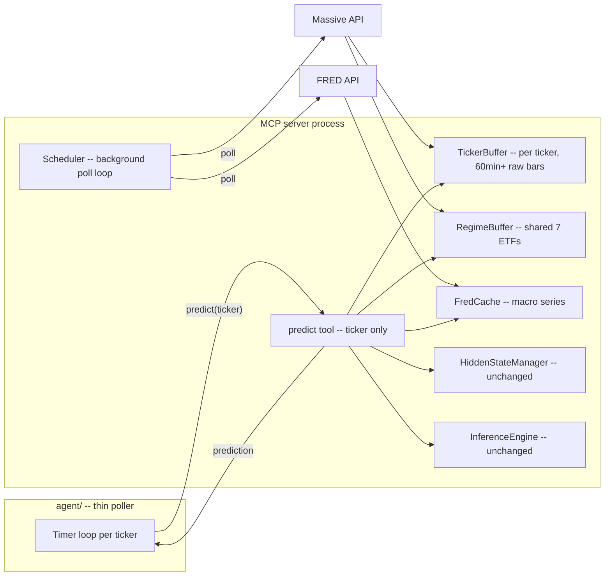

# Live Prediction Agent — Plan

Approved design (per discussion): the **server owns live data fetching, buffering, and
hidden-state continuity**; the **agent is a thin poller** that calls `predict(ticker)` on a
timer and relays/logs results. This supersedes the original "agent prefetches bars and submits a
fixture" proposal, which had a critical flaw (see "Rejected approach" below).

## Rejected approach and why

Originally proposed: agent prefetches a trailing bar window + regime/FRED data, builds a
"fixture," and submits it to the existing `predict(ticker_bars, regime_bars, fred_rows)` tool.
Flaw: `predict()` forward-passes **every row in the submitted window** through the GRU on top of
whatever hidden state was already carried over from the previous call. Repeated/overlapping
window submissions reprocess already-seen bars on top of already-advanced state, which drifts
away from the model's trained one-bar-per-step assumption, and gets worse with multiple
agents/callers for the same ticker. Fixing this by switching to a stateless-reset-per-call mode
would avoid drift but throws away intra-session memory before the window start. The chosen fix
is structural: stop requiring callers to supply bars at all, per
[docs/server-docs/plan.md](../server-docs/plan.md#5-open-question-rolling-window-features-need-history-not-just-the-latest-bar)
section 5 option (b), which was already the recommended direction.

## Target architecture

## 1. Server-side changes

### 1.1 New module: `server/live/massive_client.py`
- Thin HTTP client against `https://api.massive.com` for 1-min OHLCV bars (target ticker +
  regime ETFs), matching the `bars` schema in
  [docs/server-docs/data-readme.md](../server-docs/data-readme.md).
- Reads `MASSIVE_API_KEY` from the environment.
- Must request **split/dividend-adjusted** bars (per
  [docs/server-docs/model-deployment-spec.md](../server-docs/model-deployment-spec.md#25-splitdividend-adjustment--verified-source-data-is-already-split-adjusted)
  §2.5) — confirm the correct query param/flag with Massive's docs before wiring.
- Retry/backoff on transient errors; raise on repeated failure so the scheduler can mark a
  ticker's buffer stale rather than silently serving old data.

### 1.2 New module: `server/live/fred_client.py`
- Wraps `fredapi.Fred` (reads `FRED_API_KEY` from environment).
- Fetches the 10 series in
  [docs/server-docs/data-readme.md](../server-docs/data-readme.md#datafred_econ_data_6yrscsv)
  (`FEDFUNDS, CPIAUCSL, PPIACO, GDPC1, UNRATE, PAYEMS, CPILFESL, DGS10, DGS2, PCE`).
- Much lower refresh cadence than bars (daily is plenty, since the underlying series are
  daily/monthly/quarterly) — separate poll interval from the bars poller.
- Forward-fills onto a daily index, mirroring `fred_rows_to_df` in
  [server/data_source.py](../../server/data_source.py).

### 1.3 New module: `server/live/buffer.py`
- `TickerBuffer`: per-ticker rolling raw-bar buffer, holds >= 60 minutes (longest feature
  lookback, `past_peak_dev_60m`) plus whatever's needed for `rel_volume_20m`'s 20-bar mean — keep
  a round number like 90 minutes of headroom. Append-only with a max-age eviction.
- `RegimeBuffer`: single shared buffer (not per-ticker) for the 7 regime ETFs — fetched once per
  poll tick and reused by every tracked ticker's feature computation.
- Both expose `latest_bar_ts()` so the scheduler/predict path can tell if data is stale.

### 1.4 New module: `server/live/scheduler.py`
- Background poll loop (simple `asyncio` task or thread, timer-based per the approved decision —
  no streaming subscription for v1).
- One tick per polling interval: fetch any new regime-ETF bars (shared), then for each
  **currently tracked** ticker, fetch any new bars since its buffer's last timestamp.
- Only fetches **during market hours** — needs a trading-calendar check (e.g.
  `pandas_market_calendars` for NYSE sessions/holidays) so it doesn't poll on weekends/holidays
  or outside 09:30–16:00 ET.
- FRED polled on its own, much slower interval (e.g. once per day).

### 1.5 Dynamic ticker tracking (on-demand subscription)
- No pre-configured ticker list. The first `predict(ticker)` call for an unseen ticker:
  1. registers it with the scheduler,
  2. triggers an immediate backfill fetch of the required warmup window (≥90 min, or back to
     session open if later in the day) before anything can be predicted,
  3. returns a clear "warming up, retry shortly" response (not a prediction) until the buffer has
     enough history — avoid silently returning a prediction computed from a too-short window.
- Subsequent calls for the same ticker reuse the already-tracked buffer; the scheduler keeps
  polling it every tick for as long as it has a buffer.
- Add an eviction policy for idle tickers (e.g. drop a ticker's buffer/hidden-state after N
  minutes with no `predict` calls) so long-running server memory doesn't grow unbounded.

### 1.6 `predict` tool signature change
- `predict(ticker: str) -> dict` — drop `ticker_bars`/`regime_bars`/`fred_rows` params entirely.
- Internally: read the latest window from `TickerBuffer`/`RegimeBuffer`/`FredCache`,
  `features.build_features`, then feed **only bars newer than `HiddenStateManager`'s last
  processed timestamp for this ticker** into the model (extend `HiddenStateManager`/`StepHandle`
  to track a processed-timestamp cursor, not just session date) — this preserves true
  session-long recurrent memory and guarantees each bar is forward-passed exactly once,
  regardless of how often or how many callers call `predict` for the same ticker.
- `reset_session(ticker)` keeps working as a manual override as today.
- `model-info://contract` resource: add buffer/tracking status (e.g. which tickers are currently
  tracked, last bar timestamp) — useful for agent/operator visibility.

### 1.7 Config/secrets
- Add `MASSIVE_API_KEY`, `FRED_API_KEY` as required environment variables; fail fast at server
  startup if missing (rather than failing confusingly on first poll).
- New `server/live/config.py` (or extend `server/config.py`) for poll intervals, warmup window
  size, idle-ticker eviction timeout, trading-calendar settings.
- New deps in [pyproject.toml](../../pyproject.toml): an HTTP client (`httpx` or `requests`),
  `fredapi`, `pandas_market_calendars` (or equivalent calendar source).

## 2. Agent (`agent/` — new top-level directory, same repo)

- `agent/poller.py`: timer loop, one task per tracked ticker, calling the MCP `predict(ticker)`
  tool on an interval (default: every 1 minute, matching bar granularity) during market hours.
- `agent/config.py`: which tickers to poll, MCP server connection details, poll interval.
- Handles the "warming up" response from `predict` gracefully (backs off and retries rather than
  treating it as an error).
- Logs/relays predictions (stdout/file/webhook — simplest first: structured log lines); no
  trading-decision logic in scope for v1, per the approved "just log/relay" answer.
- No local bar-fetching, no local hidden-state tracking, no "fixture" concept needed at all —
  the agent carries no data-correctness responsibility, only scheduling and reporting.

## 3. Testing / validation

1. Unit tests for `TickerBuffer`/`RegimeBuffer` (append, dedup, eviction, staleness detection).
2. Unit tests for the new `HiddenStateManager` processed-timestamp cursor (bars at/before cursor
   are skipped; bars after are forward-passed exactly once; out-of-order bars raise rather than
   silently reorder).
3. Integration test with recorded/mocked Massive + FRED responses (no live network calls in CI) —
   simulate several poll ticks and confirm `predict(ticker)` results match a bar-by-bar replay
   through the existing, already-validated `InferenceEngine`/`HiddenStateManager` path.
4. Re-run [server/validate_against_eval.py](../../server/validate_against_eval.py) unchanged as a
   regression check that the core feature/model path is untouched by this work — only the data
   plumbing around it changes.
5. Manual smoke test against real Massive/FRED credentials for one ticker during market hours
   before enabling the agent for the full tracked set.

## 4. Sequencing

Status as of 2026-11-01: all 10 steps done.

1. [x] **Extend `HiddenStateManager` with a processed-timestamp cursor** (pure logic, no live
   deps, unit-testable). Done in [server/state.py](../../server/state.py):
   - `_TickerState` gained `last_processed_ts`; `StepHandle.commit()` now records it.
   - New `HiddenStateManager.new_timestamps(ticker, timestamps)` filters a trailing window down
     to bars after the cursor (raises `ValueError` on non-strictly-ascending input).
   - `reset`/`reset_all` now also clear the cursor (forces full replay after a manual reset).
   - Tests: [tests/test_state.py](../../tests/test_state.py) (5 cases, all passing via
     `.venv/bin/python -m unittest tests/test_state.py -v` — note: use `.venv/bin/python` in
     this repo, bare `python`/`python3` on PATH lack `torch`).
   - Regression-checked: `.venv/bin/python -m server.validate_against_eval` still passes
     unchanged after this step.
2. [x] Build `TickerBuffer`/`RegimeBuffer` (new `server/live/buffer.py`) against synthetic data.
   Includes each buffer's own max-age eviction (§1.3) — distinct from the idle-ticker eviction
   in step 5. Done:
   - `TickerBuffer`: per-ticker dict-by-timestamp store (dedup, last-write-wins), `add_bars`
     validates ticker match + required fields, evicts anything older than `max_age_ms` (default
     90 min) relative to the latest bar on every add.
   - `RegimeBuffer`: one `TickerBuffer` per regime-basket member, routes incoming bars by
     ticker, rejects bars for tickers outside the configured basket. `latest_bar_ts()` reports
     the *most-behind* member's latest timestamp, since the whole basket is only as fresh as
     its stalest ticker.
   - Tests: [tests/test_buffer.py](../../tests/test_buffer.py) (11 cases, all passing via
     `.venv/bin/python -m unittest tests/test_buffer.py -v`).
   - Regression-checked: `server.validate_against_eval` and `tests/test_state.py` still pass.
3. [x] Implement `fred_client.py` (§1.2) **with an explicit `FredCache` layer**, not just a raw
   API wrapper — cache the forward-filled daily series and refresh it on its own slow cadence
   (e.g. once per day), independent of the bars-polling interval. Done:
   - [server/live/fred_client.py](../../server/live/fred_client.py): `FredClient` lazily imports
     `fredapi.Fred` (so the module stays importable without the dep present) and reads
     `FRED_API_KEY` from the environment, raising `ValueError` if unset. `fetch_all()` pulls the
     same 10 series as [docs/server-docs/data-readme.md](../server-docs/data-readme.md), merged
     onto a common `YYYY-MM-DD` index.
   - `FredCache` wraps any duck-typed `fetch_all()` source (tested against a stub, not real
     `fredapi`/network calls) and only refetches once `refresh_interval_s` (default 1 day) has
     elapsed since the last refresh, applying `.ffill()` to the result.
   - Added `fredapi>=0.5` to [pyproject.toml](../../pyproject.toml) and installed it in
     `.venv`.
   - Tests: [tests/test_fred_cache.py](../../tests/test_fred_cache.py) (5 cases, all passing).
   - Regression-checked: `server.validate_against_eval`, `tests/test_state.py`,
     `tests/test_buffer.py` all still pass (21 tests total across the three suites).
4. [x] Implement `massive_client.py` (§1.1) against real credentials; wire both clients into
   `server/live/scheduler.py`'s poll loop (§1.4). Done:
   - [server/live/massive_client.py](../../server/live/massive_client.py): `MassiveClient`
     reads `MASSIVE_API_KEY` from the environment, lazily imports `httpx` for its default
     session (injectable for testing), requests `adjusted=true` bars (spec §2.5), retries
     transient errors 3x with exponential backoff, raises `RuntimeError` after exhausting
     retries. **Known gap, flagged inline**: the endpoint path/response-shape
     (`DEFAULT_BARS_PATH`, `_parse_bars`'s Polygon-style `t/o/h/l/c/v/vw/n` keys) are a
     best-effort guess, not yet verified against real Massive API docs/responses.
   - [server/live/scheduler.py](../../server/live/scheduler.py): `Scheduler` wires
     `MassiveClient` + `RegimeBuffer` + per-ticker `TickerBuffer`s + optional `FredCache` into a
     timer-based poll loop (`poll_once()` for a single tick, `start()`/`stop()` for a background
     thread). `track`/`untrack`/`tracked_tickers` manage which tickers are polled. A single
     ticker's fetch failure is logged and skipped, not fatal to the whole tick. **Trading-
     calendar-aware gating is deferred to step 8** — this scheduler polls every tick regardless
     of market hours for now.
   - Added `httpx>=0.27` to [pyproject.toml](../../pyproject.toml).
   - Tests: [tests/test_massive_client.py](../../tests/test_massive_client.py) (5 cases) and
     [tests/test_scheduler.py](../../tests/test_scheduler.py) (4 cases), both using stubs — no
     real network/httpx calls.
   - Regression-checked: all 30 tests (`test_state`, `test_buffer`, `test_fred_cache`,
     `test_massive_client`, `test_scheduler`) plus `server.validate_against_eval` pass.
5. [x] Add dynamic ticker tracking (§1.5): on-demand registration on first `predict(ticker)` for
   an unseen ticker, the warmup backfill fetch, and the "warming up, retry shortly" response
   while the buffer has insufficient history — plus the idle-ticker eviction policy (drop a
   ticker's buffer/hidden-state after N minutes with no `predict` calls). Done:
   - [server/live/tracker.py](../../server/live/tracker.py): `TickerTracker.ensure_ready(ticker)`
     registers an unseen ticker via `Scheduler.track`, immediately triggers a one-off warmup
     backfill fetch (instead of waiting for the next poll tick), and raises `WarmingUp`
     (carrying `ticker`/`have_ms`/`need_ms`) until the buffered window spans at least
     `DEFAULT_WARMUP_MS` (90 min). A backfill failure is logged, not raised — `WarmingUp` still
     fires and the next poll tick gets another chance.
   - `TickerTracker.evict_idle()` drops any ticker with no `ensure_ready` call in
     `idle_timeout_s` (default 30 min): untracks it from the `Scheduler` (frees its buffer) and
     calls `HiddenStateManager.reset(ticker)` (zeroes cached hidden state/cursor — noted inline
     that this doesn't remove the dict entry itself, acceptable at this scale).
   - Tests: [tests/test_tracker.py](../../tests/test_tracker.py) (7 cases, stub-based).
   - Regression-checked: all 37 tests (`test_state`, `test_buffer`, `test_fred_cache`,
     `test_massive_client`, `test_scheduler`, `test_tracker`) plus
     `server.validate_against_eval` pass.
6. [x] Set up config/secrets (§1.7): `MASSIVE_API_KEY`/`FRED_API_KEY` env vars with fail-fast
   startup validation, `server/live/config.py` for poll intervals/warmup window/eviction
   timeout/trading-calendar settings, and the new `pyproject.toml` deps (HTTP client, `fredapi`,
   `pandas_market_calendars`). Done:
   - [server/live/config.py](../../server/live/config.py): `LiveConfig` (frozen dataclass)
     collects `massive_api_key`/`fred_api_key` plus every tunable default from the other
     modules (poll interval, lookback window, buffer max age, FRED refresh interval, warmup
     window, idle timeout, regime basket). `load_live_config(env=...)` validates both required
     secrets are present and non-empty, raising one `RuntimeError` listing **every** missing var
     at once rather than failing on the first one encountered deep inside
     `massive_client.py`/`fred_client.py`.
   - Added `pandas_market_calendars>=4.0` to [pyproject.toml](../../pyproject.toml) and
     installed it in `.venv` (not wired up yet — that's step 8's trading-calendar gating).
   - Tests: [tests/test_live_config.py](../../tests/test_live_config.py) (4 cases).
   - Regression-checked: all 41 tests (`test_state`, `test_buffer`, `test_fred_cache`,
     `test_massive_client`, `test_scheduler`, `test_tracker`, `test_live_config`) plus
     `server.validate_against_eval` pass.
7. [x] Change `predict` tool signature to `predict(ticker)`; remove the pre-fetched-bars parameters
   (keep `bars_to_df`/`get_features_for_ticker` internally, just fed from buffers now instead of
   caller-supplied lists); add buffer/tracking status to `model-info://contract`. Done:
   - [server/mcp_server.py](../../server/mcp_server.py): `create_server` now wires
     `MassiveClient`/`RegimeBuffer`/`FredCache`/`Scheduler`/`TickerTracker` together (each
     independently injectable for testing; defaults built from `LiveConfig`/`load_live_config()`
     when omitted). `predict(ticker)` calls `TickerTracker.ensure_ready`, returning
     `{"status": "warming_up", ...}` if it raises `WarmingUp`; otherwise reads the ticker's
     buffer + the shared regime buffer + the FRED cache, computes features via the existing
     `get_features_for_ticker`, and uses `HiddenStateManager.new_timestamps` to forward-pass
     **only** bars after the processed cursor (one row at a time, so session-boundary resets
     stay exactly per-bar-correct). If there's nothing new since the last call, it replays a
     small per-ticker `last_prediction` cache instead of an error. `reset_session` now also
     clears that cache. `model-info://contract` gained `regime_tickers`/`regime_latest_bar_ts`/
     `tracked_tickers` (with each tracked ticker's latest buffered timestamp) plus a new known
     risk pointing at §6's unverified Massive API assumptions.
   - Tests: [tests/test_mcp_server.py](../../tests/test_mcp_server.py) (4 cases) exercise the
     real checkpoint/`InferenceEngine` end-to-end through the actual `mcp` SDK's
     `call_tool`/`read_resource` API (per the SDK's `CallToolResult.structured_content`), with
     stubbed `MassiveClient`/`FredCache` — covering warming-up, ready-with-prediction,
     cached-replay-on-no-new-bars, and reset-then-recompute.
   - Regression-checked: all 45 tests (`test_state`, `test_buffer`, `test_fred_cache`,
     `test_massive_client`, `test_scheduler`, `test_tracker`, `test_live_config`,
     `test_mcp_server`) plus `server.validate_against_eval` pass.
8. [x] Add the trading-calendar-aware poll gating (market hours/holidays) to the scheduler. Done:
   - [server/live/calendar.py](../../server/live/calendar.py): `MarketCalendar` wraps
     `pandas_market_calendars`'s NYSE calendar (lazy import), caching each date's open/close
     bounds after the first lookup. `is_open(now_ms)` answers true only within regular trading
     hours on an actual trading day (false on weekends/holidays/outside 09:30-16:00 ET).
   - [server/live/scheduler.py](../../server/live/scheduler.py): `Scheduler` takes an optional
     `market_calendar`; the background loop (`_run`) skips `poll_once()` entirely on a tick
     where the market is closed. **`poll_once()` itself stays ungated** — `TickerTracker`'s
     warmup backfill calls `MassiveClient.fetch_bars` directly (not through the scheduler), so a
     newly registered ticker still gets its warmup data immediately regardless of market hours.
   - `create_server` now builds a `MarketCalendar(live_cfg.calendar_name)` by default when no
     `scheduler`/`market_calendar` is injected; `LiveConfig` gained `calendar_name` (default
     `"NYSE"`).
   - Tests: [tests/test_calendar.py](../../tests/test_calendar.py) (5 cases, against the real
     NYSE calendar — no network needed, the library's schedule data is local) and two new cases
     in [tests/test_scheduler.py](../../tests/test_scheduler.py) exercising the background
     thread (`start()`/`stop()`) with a stub calendar to confirm ticks are skipped when closed
     and still run when open.
   - Regression-checked: all 52 tests plus `server.validate_against_eval` pass.
9. [x] Build the `agent/` poller against the new `predict(ticker)` signature. Done:
   - [agent/config.py](../../agent/config.py): `AgentConfig` (tickers + poll interval).
   - [agent/poller.py](../../agent/poller.py): `Poller` calls `server.call_tool("predict",
     {"ticker": ...})` for each configured ticker on a timer, gated on market hours via an
     optional `market_calendar` (per the "reasonable window to predict" discussion — outside
     market hours the server would otherwise just return `warming_up`/stale-cached responses, so
     the agent doesn't bother calling at all). A single ticker's failure is logged and skipped,
     matching `Scheduler.poll_once`'s per-ticker isolation. `_log_result` differentiates
     `"ok"`/`"warming_up"`/other statuses in its log line rather than treating `warming_up` as
     an error. `main()` wires a real `create_server()` + `MarketCalendar()` behind a small CLI
     (`python -m agent.poller AAPL MSFT --poll-interval-s 60`).
   - Tests: [tests/test_poller.py](../../tests/test_poller.py) (5 cases, stub async
     server/calendar — no real MCP server, network, or model loading).
   - Regression-checked: all 57 tests plus `server.validate_against_eval` pass.
10. [x] Update `docs/server-docs/` alongside each step, not as one final pass. Done:
    - [docs/server-docs/plan.md](../server-docs/plan.md): §2's module layout now notes the live
      work landed as `server/live/` rather than inside `data_source.py`; §5 marked resolved
      (option (b) was implemented); §8 step 7 marked done, pointing here.
    - [docs/server-docs/model-deployment-spec.md](../server-docs/model-deployment-spec.md):
      §2.4 notes `predict(ticker)` no longer takes bars as input (the listed requirements now
      describe the server's internal pipeline, not a caller contract); §2.6 notes the
      processed-bar cursor addition.
    - Final regression check: all 57 tests plus `server.validate_against_eval` pass.

## 4.1 Post-plan fixes (2026-11-03, discovered via manual smoke testing)

Running `agent/poller.py` for real against live credentials surfaced issues the stub-based tests
couldn't catch (by design — they never touch the real Massive API). Fixed as they were found:

1. **`httpx` was never actually installed** — added to `pyproject.toml` in step 4 but the
   `pip install` step was missed. Fixed (installed).
2. **`agent/poller.py`'s market-hours gating was silent** — `run()` skipped ticks with zero log
   output when the market was closed, making it look hung. Fixed: logs `"market is open/closed"`
   once per state transition.
3. **The hand-rolled `massive_client.py` guessed at the wrong API entirely.** The real Massive
   API isn't a bare REST endpoint to call directly — it's `pip install massive`, the *official*
   Massive (formerly Polygon.io) SDK, confirmed via its PyPI metadata (`massive.com`, `Official
   Massive (formerly Polygon.io) REST and Websocket client`) and source
   (`massive/rest/__init__.py`: `BASE = "https://api.massive.com"`,
   `ENV_KEY = "MASSIVE_API_KEY"` — both already correct in our config by coincidence). Fixed:
   `MassiveClient` now wraps `massive.RESTClient.get_aggs(ticker, 1, "minute", from_=..., to=...,
   adjusted=True, sort="asc")` instead of hand-rolled `httpx` calls against a guessed
   `/v1/bars` path (which 404'd). Replaced `httpx` with `massive>=2.9` in
   [pyproject.toml](../../pyproject.toml); rewrote
   [tests/test_massive_client.py](../../tests/test_massive_client.py) to stub the SDK's
   `get_aggs` interface instead of an HTTP session. **This resolves the §6 "Massive API shape"
   open item below** — the endpoint/response shape is no longer a guess.
4. **Retry logic didn't distinguish permanent errors from transient ones.** A real response
   (`{"status":"NOT_AUTHORIZED", "message":"Your plan doesn't include this data timeframe..."}`,
   e.g. a regime ETF not covered by the account's current Massive/Polygon plan tier) was retried
   3x with backoff before failing — wasted time/API quota on a request that could never succeed.
   Fixed: `MassiveClient.fetch_bars` now fails fast (no retries) when the error message matches
   `NON_RETRYABLE_ERROR_MARKERS` (`NOT_AUTHORIZED`/`UNAUTHORIZED`/`FORBIDDEN`).
5. **One failing regime ticker aborted the whole regime-basket fetch.** `fetch_bars_for_many` let
   a single ticker's exception propagate, which meant `Scheduler.poll_once()`'s regime-bars
   fetch raised and the *entire* regime buffer went unupdated that tick — not just the one
   problem ticker. Fixed: `fetch_bars_for_many` now catches and logs each ticker's failure
   individually and returns whatever subset of tickers succeeded, mirroring
   `Scheduler.poll_once`'s existing per-tracked-ticker isolation. A missing regime ticker simply
   zeroes its feature columns downstream (already-documented, graceful degradation), rather than
   blocking every other regime ETF's data too.
   - Tests added for both: [tests/test_massive_client.py](../../tests/test_massive_client.py)
     `test_non_retryable_error_fails_fast`, `test_fetch_bars_for_many_isolates_per_ticker_failure`.
   - Regression-checked: all 59 tests plus `server.validate_against_eval` pass.
6. **Confirmed root cause of the `NOT_AUTHORIZED` error: a delayed-data plan tier (e.g. Polygon/
   Massive "Stocks Starter," 15-min delay), not an account/data-access problem per ticker.** It
   initially looked ticker-specific (only `SPY` failed), but then escalated to *every* ticker
   (`AAPL`, `MSFT`, `USD`) — the actual cause was requesting bars all the way up to the literal
   current timestamp, which falls inside the plan's real-time-restricted window regardless of
   ticker. Fixed: added a configurable delay buffer so fetch windows never request data more
   recent than `data_delay_ms` old.
   - [server/live/scheduler.py](../../server/live/scheduler.py): new `DEFAULT_DATA_DELAY_MS`
     (16 min = Starter's 15-min delay + 1-min safety buffer) and a `data_delay_ms` constructor
     param; `poll_once()` computes `end_ms = now_ms() - data_delay_ms`.
   - [server/live/tracker.py](../../server/live/tracker.py): `_backfill()` applies the same
     delay (imports the shared default from `scheduler.py`).
   - [server/live/config.py](../../server/live/config.py): `LiveConfig.data_delay_ms`, overridable
     via a new `MASSIVE_DATA_DELAY_MS` env var (milliseconds) for accounts with a different delay.
   - [server/mcp_server.py](../../server/mcp_server.py): wires `live_cfg.data_delay_ms` into both
     `Scheduler` and `TickerTracker`.
   - Also fixed the misleading `"after 3 attempts"` error message (from fix #4 above) to report
     the *actual* attempt count, since non-retryable errors now bail after just 1 attempt.
7. **Startup race: `predict()` could run before the scheduler's first background poll tick
   populated the regime buffer.** An empty regime buffer doesn't zero-fill the 10 regime-derived
   feature columns — it drops them entirely (42 → 32 columns), crashing the model's fixed-size
   input projection with a shape-mismatch error. This surfaced as the *first* ticker in a batch
   failing while later ones (processed after the background thread caught up) succeeded. Fixed:
   - `create_server(start_scheduler=True)` now calls `sched.poll_once()` **synchronously once**
     before starting the background thread, priming the regime buffer before any `predict()`
     call can race it (failure here is caught and logged, not fatal to server startup).
   - Added a defensive safety net in `predict()` itself: if the computed feature matrix doesn't
     have exactly 42 columns (regime buffer empty/incomplete for any other reason, e.g. after an
     eviction or a future bug), return `{"status": "data_unavailable", "reason": ...}` instead of
     letting the shape mismatch crash the model.
   - Tests: [tests/test_mcp_server.py](../../tests/test_mcp_server.py)
     `test_predict_data_unavailable_when_regime_buffer_empty`,
     `test_create_server_primes_regime_buffer_on_startup`.
   - Regression-checked: all 61 tests plus `server.validate_against_eval` pass.
8. **Remaining external/account-level limitation (not a code bug):** the Massive/Polygon
   account's plan tier determines which data timeframes are accessible at all (e.g. a plan with
   no minute-level data, vs. one with a 15-min delay) — upgrading the plan (per the error's own
   message/link) is the only fix for that; the code now requests appropriately-delayed data,
   fails fast on non-retryable errors, and isolates per-ticker/startup-timing failures instead of
   crashing or wasting retries.

## 5. Carried-over risks (unchanged from the existing model contract)

- No `ticker_id` — model has no per-ticker identity signal.
- No peak≥close≥dip constraint enforced — agent/consumer should sanity-check downstream.
- Only `checkpoints/best_model.pt` (baseline, unnormalized) is rigorously validated — serve this
  by default.
- Model accuracy only verified on the 23 training tickers and the historical test window — an
  on-demand-tracked ticker outside that set is unverified territory.
- Split/dividend-adjustment convention from Massive must match what the model was trained on —
  verify the live API's adjustment flag matches Polygon's "fully adjusted" convention used in
  training (per [docs/server-docs/model-deployment-spec.md §2.5](../server-docs/model-deployment-spec.md#25-splitdividend-adjustment--verified-source-data-is-already-split-adjusted)).

## 6. Open items / unverified assumptions (debugging reference)

Things implemented against a best guess rather than confirmed real-world behavior. Check these
first if `MassiveClient`/`Scheduler` misbehave against the real API.

### Massive API shape (`server/live/massive_client.py`) — **RESOLVED 2026-11-03, see §4.1**

The subsections below are kept for historical/debugging reference (they describe the original
hand-rolled-HTTP design and why it 404'd), but the actual fix was simpler than "guess harder":
Massive ships an **official SDK** (`pip install massive`), and `massive_client.py` now wraps it
(`massive.RESTClient.get_aggs`) instead of hand-rolling requests. The items below no longer
apply to the current code, except the adjustment-semantics and rate-limit notes, which are still
worth double-checking.

~~None of this has been checked against Massive's actual API reference or a real response — it
was written from the base URL alone (`https://api.massive.com`), by analogy to Polygon's bar
schema (since docs/server-docs/data-readme.md notes Massive wraps Polygon data):~~

- ~~**Endpoint path**: `DEFAULT_BARS_PATH = "/v1/bars"` — guessed, not confirmed.~~
- **Query params**: `ticker`, `start`, `end`, `adjusted=true`, `timespan=minute` — guessed names;
  Massive may use different param names, date formats (ISO strings vs. epoch ms), or require
  pagination (`next_url`/cursor) for large ranges that this client doesn't handle at all.
- **Auth**: assumed `Authorization: Bearer <MASSIVE_API_KEY>` header — Massive may instead want
  an API-key query param, a different header name, or OAuth.
- **Response shape**: `_parse_bars` assumes `{"results": [{"t", "o", "h", "l", "c", "v", "vw",
  "n"}, ...]}` (Polygon's own aggregate-bar field names). If Massive's wrapper renames/nests
  these differently, `_parse_bars` will raise a `KeyError`/`TypeError` inside the retry loop,
  which currently surfaces as a generic `RuntimeError: failed to fetch bars for ... after 3
  attempts` — **the real error is swallowed by the retry `except Exception`**; when debugging,
  temporarily log `exc` with a full traceback (or catch non-transient errors like `KeyError`
  separately and fail fast instead of retrying 3x) to see the actual mismatch.
- **Adjustment semantics**: `adjusted=true` is assumed to mean "split + dividend adjusted" per
  Polygon's convention — confirm this is actually what Massive returns, not just split-adjusted
  (see the carried-over risk above; feeding the wrong adjustment convention won't error, it'll
  silently degrade predictions).
- **Rate limits**: not handled at all — no rate-limit-aware backoff distinct from the generic
  transient-error retry; if Massive returns 429s, verify `MAX_RETRIES`/`RETRY_BACKOFF_S` are
  adequate or add explicit `Retry-After` header handling.

### How to verify once real API access is available

1. Make one manual `fetch_bars()` call against a known liquid ticker (e.g. `AAPL`) during market
   hours, log the raw response body, and diff it against the assumed shape above.
2. Update `DEFAULT_BARS_PATH`/query params/`_parse_bars` to match, then re-run
   [tests/test_massive_client.py](../../tests/test_massive_client.py) (the stub-based tests
   won't catch a real-API mismatch themselves — update the stub payloads to match the real shape
   too, so the tests stay meaningful).
3. Re-run the regression suite (`server.validate_against_eval` + all unit tests) to confirm
   nothing downstream broke.

### FRED API shape (`server/live/fred_client.py`)

- `FredClient.fetch_all()` assumes `fredapi.Fred.get_series(series_id)` returns a plain
  date-indexed `pandas.Series` that merges cleanly into one `DataFrame` across all 10 series —
  only exercised against a stub data source in
  [tests/test_fred_cache.py](../../tests/test_fred_cache.py), never a real `FRED_API_KEY`/live
  response. Verify once a real key is available: check the index dtype/timezone and whether any
  series returns gaps/duplicate dates that `pd.DataFrame(columns)` doesn't align the way assumed.

### Ticker tracking (`server/live/tracker.py`)

- **Silent backfill failures**: `TickerTracker._backfill` logs and swallows any
  `MassiveClient.fetch_bars` exception during warmup. A persistently failing backfill (e.g. the
  Massive API-shape mismatches above) leaves a ticker stuck raising `WarmingUp` forever with no
  error surfaced to the caller beyond that — when debugging a ticker that never leaves "warming
  up," check the server logs for this, not just the `predict` response.
- **`evict_idle()` doesn't free `HiddenStateManager` memory**: it calls `reset(ticker)`, which
  zeroes the cached hidden state/cursor but leaves the dict entry (and its per-ticker lock) in
  place — functionally equivalent to a fresh start, but not a true memory reclaim. Fine at
  today's scale; revisit if the server tracks a very large/high-churn set of tickers over time.

