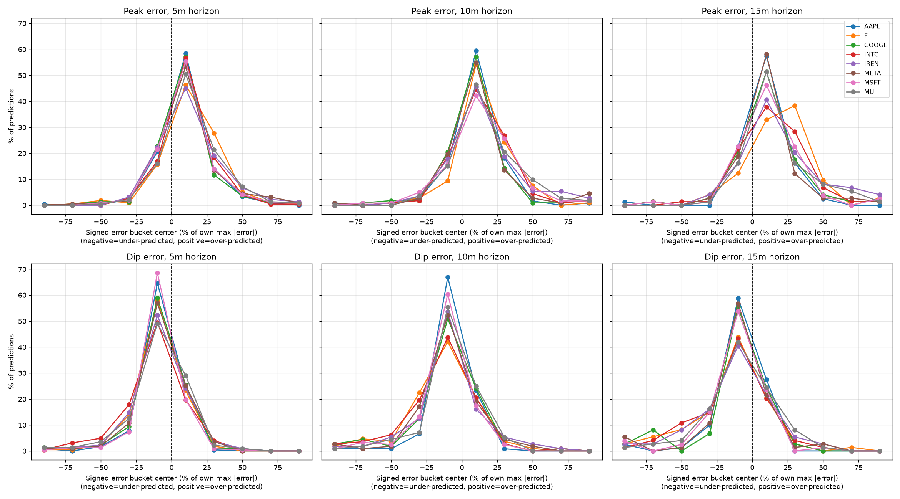

# Live Prediction Model Analysis

Analysis of 4 days of live `agent.poller` output (2026-11-03 through 2026-11-06), combining
`predictions_11032026.jsonl`, `predictions_11042026.jsonl`, `predictions_11052026.jsonl`, and
`predictions-11062026.jsonl` across 8 tickers (AAPL, F, GOOGL, INTC, IREN, META, MSFT, MU). See
[model-improvement-roadmap.md](./model-improvement-roadmap.md) for the roadmap this responds to,
and [scripts/evaluate_live_predictions.py](../../scripts/evaluate_live_predictions.py) for the
non-overlapping-window evaluation harness used to produce the headline stats below.

## Summary

With a statistically meaningful sample (70–245 non-overlapping observations per ticker/horizon
cell, vs. ~6–19 in the original single-day AAPL/MSFT run), two systematic, model-wide issues are
now confirmed rather than suspected:

1. A **peak-over/dip-under calibration bias** whose magnitude scales with ticker price level.
2. A **persistent upward ("bullish") directional bias** in predictions that does not track actual
   market direction, and that amplifies rather than attenuates with longer horizons.

Directional accuracy is flat around 50% for every ticker and horizon — there is no evidence the
model carries a usable directional trading signal.

## 1. Peak-over/dip-under bias, scaled by price level

Every ticker, at every horizon, shows the same sign pattern: peak error positive (over-predicted),
dip error negative (under-predicted). The magnitude tracks the ticker's dollar price level (with
MU as a volatility-driven outlier):

| Ticker | ~price | peak error range (5m -> 15m) |
|---|---|---|
| F     | ~$12  | +0.02 to +0.04 |
| IREN  | ~$15-20 | +0.16 to +0.34 |
| INTC  | ~$24  | +0.23 to +0.43 |
| AAPL  | ~$270 | +0.40 to +0.72 |
| GOOGL | ~$180 | +0.49 to +0.97 |
| MSFT  | ~$420 | +0.78 to +1.33 |
| META  | ~$600 | +1.27 to +2.64 |
| MU    | volatile | +3.8 to +8.5 |

Error magnitude also grows with horizon for every ticker (5m < 10m < 15m), which is expected on
its own, but the price-scaling pattern is new: it suggests the bias behaves like a
percentage-ish error that hasn't been normalized out, pointing at the open comparison between the
baseline and normalized-feature checkpoints (see
[model-improvement-roadmap.md](./model-improvement-roadmap.md) item 5).

Band coverage (fraction of actual prices falling within `[dip, peak]`) is uniformly ~46-62%
across all tickers/horizons — consistent with a band that is miscalibrated (too narrow or
off-center) rather than a per-ticker data issue.

## 2. No real directional signal; persistent upward bias

Directional accuracy (does the predicted peak/dip midpoint move the same way as the actual price?)
is flat across the board: 43.8%-58.0% across all 24 ticker/horizon combinations, with 95% CIs
mostly straddling 50%. This generalizes the original AAPL/MSFT finding to all 8 tickers.

Looking at direction specifically (all overlapping 1-min-apart samples, n ~1000-1200 per cell):

| | % predictions calling "up" | % actual moves "up" |
|---|---|---|
| typical range | 50-58% | 39-48% |

Every ticker predicts "up" more often than the market actually moved up. The gap is largest for
MU (56-58% predicted-up vs. ~39-42% actual-up) and F (54-57% vs. ~39-41%).

**The bias amplifies with horizon** for several tickers instead of attenuating:

- F: 54.2% -> 55.9% -> 57.2% predicted-up (5 -> 10 -> 15m), actual-up stays flat (~40%)
- MU: 55.8% -> 56.8% -> 58.4%
- IREN: 53.8% -> 55.2% -> 56.8%

The longer the model looks ahead, the more confidently it leans "up" — the opposite of what you'd
expect if longer horizons carried more genuine uncertainty rather than more directional
conviction.

Pearson correlation between predicted-direction magnitude and actual-direction magnitude is near
zero or negative for most tickers, and gets worse with horizon for some:

- GOOGL: -0.153 -> -0.225 -> -0.169
- META: -0.166 -> -0.234 -> -0.289 (monotonically worse)
- AAPL: -0.100 -> -0.052 -> -0.101

Only INTC and IREN show weak positive correlation (0.01-0.15), which is within noise. Negative
correlation means that when the model predicts a larger upward move, the actual move tends to be
flatter or even negative — the opposite of a usable signal.

## 3. Error magnitude distribution (percentiles and relative concentration)

Non-overlapping peak/dip errors (`pred - actual`) as a percentage of actual price, e.g. AAPL:

| Horizon | n | peak p5 | p25 | **p50** | p75 | p95 | dip p5 | p25 | **p50** | p75 | p95 |
|---|---|---|---|---|---|---|---|---|---|---|---|---|
| 5m | 243 | -0.18% | +0.00% | **+0.11%** | +0.22% | +0.47% | -0.54% | -0.24% | **-0.10%** | 0.00% | +0.17% |
| 10m | 121 | -0.16% | +0.04% | **+0.14%** | +0.32% | +0.63% | -0.84% | -0.34% | **-0.15%** | -0.02% | +0.21% |
| 15m | 80 | -0.25% | +0.02% | **+0.22%** | +0.41% | +0.69% | -0.95% | -0.35% | **-0.15%** | +0.01% | +0.16% |

Converting dollar errors to % of price shows AAPL's larger-looking dollar errors (vs. a
low-priced ticker like F) are almost entirely explained by AAPL's higher share price, not a worse
model fit in relative terms — consistent with the price-scaling pattern in section 1.

Bucketing each ticker's absolute % error (`|pred - actual| / actual`) into quartiles of that
ticker's own max observed error (pooled across 5/10/15m, non-overlapping) shows errors are
heavily right-skewed, not uniformly noisy:

| Ticker | n | Peak 0-25% | 25-50% | 50-75% | 75-100% | Dip 0-25% | 25-50% | 50-75% | 75-100% |
|---|---|---|---|---|---|---|---|---|---|
| AAPL | 444 | 94.4% | 4.5% | 0.9% | 0.2% | 95.5% | 3.2% | 0.7% | 0.7% |
| F | 396 | 82.1% | 15.9% | 1.3% | 0.8% | 84.3% | 10.6% | 4.3% | 0.8% |
| GOOGL | 410 | 91.2% | 6.1% | 1.7% | 1.0% | 89.0% | 5.6% | 3.4% | 2.0% |
| INTC | 410 | 85.1% | 12.4% | 1.5% | 1.0% | 81.2% | 13.7% | 4.4% | 0.7% |
| IREN | 410 | 80.0% | 12.9% | 5.1% | 2.0% | 81.5% | 14.4% | 2.9% | 1.2% |
| META | 408 | 90.4% | 6.9% | 2.5% | 0.2% | 90.4% | 6.4% | 1.7% | 1.5% |
| MSFT | 443 | 88.5% | 9.0% | 1.8% | 0.7% | 91.2% | 5.4% | 2.3% | 1.1% |
| MU | 410 | 83.9% | 13.4% | 2.4% | 0.2% | 86.8% | 10.7% | 1.7% | 0.7% |

80-95% of predictions per ticker fall in the lowest ("0-25% of that ticker's own worst miss")
bucket, with only a small tail (1-2%, up to ~5% for IREN peak) in the largest-error bucket. This
is a reassuring *shape* — errors are usually small and consistent with occasional outliers,
rather than uniformly noisy — but it does not contradict sections 1-2: the systematic bias (median
error never at 0%) is present even within the "small error" bucket, and band coverage/directional
accuracy are unaffected by this finding. Small, *consistently biased* errors are arguably a more
fixable problem (calibration/scale correction) than large, random ones — reinforcing the
normalized-checkpoint comparison as the most promising next step (section 1, item 5 below).

Note: the bucket percentages are scaled per-ticker against each ticker's own max error, so they
show error *shape* (concentration vs. spread) per ticker, not a magnitude comparison across
tickers — use the percentile tables above (or section 1's dollar table) for that.

### Finer-grained view: 10%-wide buckets

Repeating the same bucketing with 10 buckets (10% increments instead of 25%) confirms the decay
is smooth and monotonic rather than a sharp cliff — a genuine long-tail distribution, not a
bimodal "mostly tiny or mostly huge" split.

**PEAK** — % of predictions in each bucket (relative to that ticker's own max error):

| Ticker | n | 0-10% | 10-20% | 20-30% | 30-40% | 40-50% | 50-60% | 60-70% | 70-80% | 80-90% | 90-100% |
|---|---|---|---|---|---|---|---|---|---|---|---|
| AAPL | 444 | 64.2% | 23.9% | 8.8% | 1.6% | 0.5% | 0.5% | 0.2% | 0.2% | 0.0% | 0.2% |
| F | 396 | 38.9% | 30.1% | 18.2% | 7.1% | 3.8% | 0.8% | 0.5% | 0.0% | 0.3% | 0.5% |
| GOOGL | 410 | 65.4% | 20.5% | 7.6% | 3.2% | 0.7% | 1.2% | 0.5% | 0.5% | 0.2% | 0.2% |
| INTC | 410 | 47.6% | 29.5% | 12.0% | 5.6% | 2.9% | 1.2% | 0.0% | 0.5% | 0.2% | 0.5% |
| IREN | 410 | 44.4% | 27.1% | 13.7% | 5.1% | 2.7% | 3.2% | 1.2% | 1.2% | 0.7% | 0.7% |
| META | 408 | 66.4% | 20.1% | 6.4% | 3.4% | 1.0% | 1.0% | 0.7% | 0.7% | 0.0% | 0.2% |
| MSFT | 443 | 55.1% | 25.5% | 11.1% | 4.5% | 1.4% | 0.9% | 0.7% | 0.5% | 0.2% | 0.2% |
| MU | 410 | 55.9% | 22.4% | 12.2% | 4.6% | 2.2% | 1.0% | 1.0% | 0.5% | 0.0% | 0.2% |

**DIP** — % of predictions in each bucket:

| Ticker | n | 0-10% | 10-20% | 20-30% | 30-40% | 40-50% | 50-60% | 60-70% | 70-80% | 80-90% | 90-100% |
|---|---|---|---|---|---|---|---|---|---|---|---|
| AAPL | 444 | 74.1% | 18.5% | 4.1% | 1.6% | 0.5% | 0.0% | 0.7% | 0.0% | 0.2% | 0.5% |
| F | 396 | 53.8% | 22.7% | 13.9% | 2.8% | 1.8% | 2.5% | 1.5% | 0.3% | 0.5% | 0.3% |
| GOOGL | 410 | 60.0% | 23.9% | 7.3% | 2.4% | 1.0% | 0.7% | 1.7% | 2.2% | 0.2% | 0.5% |
| INTC | 410 | 48.8% | 28.0% | 8.5% | 6.1% | 3.4% | 2.7% | 1.0% | 1.0% | 0.2% | 0.2% |
| IREN | 410 | 51.2% | 23.2% | 11.0% | 6.1% | 4.4% | 1.2% | 1.5% | 0.2% | 0.5% | 0.7% |
| META | 408 | 62.3% | 23.5% | 6.6% | 3.7% | 0.7% | 1.0% | 0.2% | 0.7% | 1.0% | 0.2% |
| MSFT | 443 | 67.5% | 18.1% | 8.1% | 2.3% | 0.7% | 1.6% | 0.7% | 0.0% | 0.7% | 0.5% |
| MU | 410 | 59.0% | 23.2% | 8.0% | 4.6% | 2.7% | 0.5% | 0.7% | 0.7% | 0.0% | 0.5% |

Roughly half-to-two-thirds of predictions land in the very first (0-10%) bucket, with each
subsequent bucket holding progressively fewer — confirming the long-tail shape. AAPL/GOOGL/META
are the most front-loaded (tight, few outliers); F and IREN decay more slowly (more frequent
mid-size misses), consistent with the coarser 25%-bucket summary above. These buckets carry the
same caveats as the 25%-bucket table: sign-agnostic (built from `abs(pred - actual)`, so it
mixes overshoot and undershoot misses of the same magnitude) and scaled per-ticker against that
ticker's own max error (shape only, not a cross-ticker magnitude comparison).

### Visualizing the asymmetry

The absolute-error buckets above hide direction. Plotting the *signed* error (`pred - actual`),
normalized per ticker **and per horizon separately** (not pooled — error magnitude grows with
horizon, so pooling would let the 15m tail dominate each ticker's normalization and distort where
5m/10m errors land on the shared axis) so each panel shares a common [-100%, +100%] x-axis, makes
the asymmetry directly visible across all three horizons:



Every ticker's peak-error curve peaks on the positive (over-predicted) side of 0 at every
horizon, and every dip-error curve peaks on the negative (under-predicted) side — a visibly
off-center distribution, not noise centered on 0, and the bias holds up consistently whether you
look at 5m, 10m, or 15m individually. F has the fattest positive-side tail in the peak charts
(consistent with it decaying more slowly in the bucket tables above); AAPL/GOOGL/META are the
most tightly concentrated right at the first off-zero bucket, especially at 5m.

Reproducible via [scripts/plot_error_distribution.py](../../scripts/plot_error_distribution.py):
```
.venv/bin/python -m scripts.plot_error_distribution predictions.jsonl --output chart.png
```

## Conclusions

- The peak-over/dip-under bias first observed on the single-day AAPL/MSFT run
  ([model-improvement-roadmap.md](./model-improvement-roadmap.md) item 3) is confirmed real and
  model-wide, not ticker-specific or a sampling artifact.
- There is no evidence of a usable directional trading signal in the 5/10/15-min predictions for
  any of the 8 tickers tested.
- The model has a persistent upward directional bias independent of actual market behavior, which
  gets stronger (not weaker) at longer horizons for several tickers.
- Error magnitude scaling with ticker price level is new evidence pointing at a normalization gap;
  the baseline-vs-normalized-checkpoint comparison
  ([model-improvement-roadmap.md](./model-improvement-roadmap.md) item 5) is now the most
  actionable next step to investigate whether the normalized checkpoint corrects this.

## Data / methodology notes

- Combined file: concatenation of the 4 daily JSONL logs (9,480 total lines), evaluated with
  `scripts.evaluate_live_predictions` for the headline non-overlapping-window stats (section 1)
  and an ad-hoc script for the directional-bias breakdown (section 2), using all overlapping
  1-minute-apart samples (larger n, appropriate here since the question is about mean bias/
  correlation rather than a point-estimate accuracy percentage).
- Match tolerance for pairing a prediction with its realized actual price: 90 seconds.
