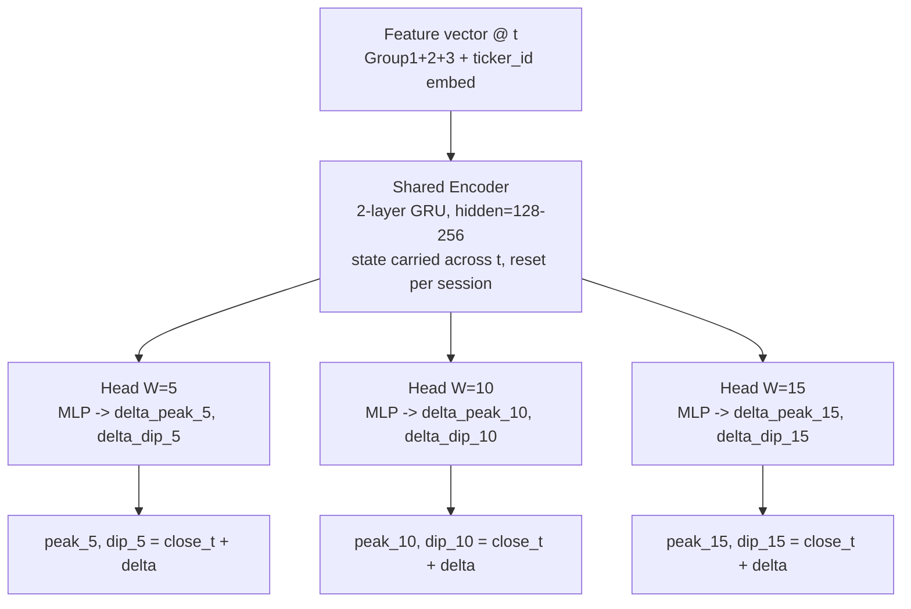

# Price Prediction Model — Model Design (First Cut)

## Objective recap

Given the joined feature vector/sequence at time `t` (see [price-prediction-feature-design.md](./price-prediction-feature-design.md)), predict `(peak_price_W, dip_price_W)` for each configured horizon `W ∈ {5, 10, 15}`, as raw price levels via a `close[t] + delta` residual formulation.

This is a **multi-horizon, multi-target regression** problem over **multivariate time series**, with a shared sequence encoder and per-horizon heads.

---

## 1. Architecture

### 1.1 Shared encoder

Options, roughly in order of recommended starting point:

| Option | Pros | Cons |
| --- | --- | --- |
| **GRU/LSTM (stacked, 2–3 layers)** | Simple, cheap, handles streaming/stateful single-row-at-a-time inference naturally (matches "one row at a time" requirement), strong baseline for financial time series | Limited long-range context unless state is carried carefully across session boundaries |
| **Temporal Convolutional Network (TCN)** | Parallelizable training, large effective receptive field via dilation, stable gradients | Needs an explicit lookback window `L` rather than pure recurrent state; less natural for step-at-a-time streaming |
| **Transformer (encoder-only, causal)** | Best at capturing longer-range cross-feature interactions, attention weights are interpretable | Needs fixed-length lookback window, more data/compute hungry, overkill for a first cut |

**Recommendation for first cut:** 2-layer GRU (hidden size 128–256), consuming the single joined feature vector per step and carrying hidden state across steps within a session (reset at session boundaries per the data-hygiene notes). This directly matches the "features passed one row at a time" design and gives a fast, debuggable baseline. A Transformer/TCN variant with explicit lookback `L` (e.g. 60) can be a v2 experiment once the GRU baseline and data pipeline are validated.

### 1.2 Input handling

- Numeric features: standard projection (`Linear` layer) into the encoder's input dimension, after per-feature-group normalization (z-score or returns, fit on train only).
- `ticker_id` (if multi-ticker): small learned embedding (e.g. dim 8–16), concatenated with numeric features before the encoder. Lets one model share capacity across the 23 tickers while still learning ticker-specific quirks.
- Missing/stale macro features: pass `days_since_macro_update` as a feature (already planned) rather than imputing — lets the model learn to discount stale macro signal itself.

**Implementation status:** the frozen baseline checkpoint (`checkpoints/best_model.pt`, see [docs/plan.md](./plan.md)) does **not** apply z-score normalization — raw engineered feature values are fed directly to the input projection, and `ticker_id` embedding was never added. An experimental z-scored-feature variant lives in the source `ai-trading-model` repo's `train_normalized.py` / `evaluate_normalized.py` (mean/std fit on train only, applied to train/val/test), trained via [server/train_config_normalized.yaml](../server/train_config_normalized.yaml) into a separate checkpoint (`checkpoints/best_model_normalized.pt`) so it can be compared head-to-head against the unnormalized baseline without touching it. See [docs/model-deployment-spec.md](./model-deployment-spec.md) for the exact contract difference between the two checkpoints.

### 1.3 Per-horizon output heads

- Shared encoder output `h_t` (final hidden state, or output at step `t`) feeds into `len(horizons)` independent small MLP heads (e.g. 1 hidden layer, size 64, ReLU).
- Each head outputs 2 values: `delta_peak_W`, `delta_dip_W` (scale-normalized residuals).
- Final prediction: `peak_price_W = close[t] + denormalize(delta_peak_W)`, `dip_price_W = close[t] + denormalize(delta_dip_W)`.
- A `softplus`/`exp` can constrain `delta_peak_W >= 0` and `delta_dip_W <= 0` if you want to hard-enforce "peak is above close, dip is below close" — optional but cheap to add and removes a class of nonsensical predictions, especially early in training.

### 1.4 Diagram



---

## 2. Target normalization (the `delta`)

Raw `(peak_price_W - close[t])` spans very different scales across tickers (e.g. NVDA vs F) and across the 5-year window. Normalize per-ticker, per-horizon, using **volatility-scaled deltas** rather than a global scaler:

```
delta_peak_W = (peak_price_W - close[t]) / (close[t] * realized_vol_15m[t] + eps)
delta_dip_W  = (dip_price_W  - close[t]) / (close[t] * realized_vol_15m[t] + eps)
```

This keeps the regression target roughly in a similar numeric range (a small multiple of recent volatility) regardless of ticker price level or regime, and the model already has `realized_vol_15m` as an input so it isn't inventing information. At inference, invert the same transform to recover the raw price. Fit any residual static scaler (e.g. clipping outliers) on train split only.

---

## 3. Loss function

- Base loss per head: **Huber/Smooth-L1** on the normalized delta (more robust to the fat-tailed outliers common in intraday price moves than plain MSE).
- Total loss: sum (or weighted sum) across horizons and across `{peak, dip}`:

```
L = Σ_W [ w_W * ( Huber(delta_peak_W_pred, delta_peak_W_true) + Huber(delta_dip_W_pred, delta_dip_W_true) ) ]
```

  - Start with equal `w_W = 1`; revisit if shorter horizons dominate the loss (they tend to have smaller magnitude/variance) by tuning per-horizon weights or normalizing loss by target variance per horizon.
- Optional secondary loss term: penalize **peak < dip** sign violations if you don't hard-constrain in the architecture (see §1.3), as a cheap regularizer.
- Consider also tracking (not necessarily training on) a **directional accuracy** metric — did the model correctly predict whether peak/dip move up/down from `close[t]` — since that's often more decision-relevant than raw price error for a trading use case.

---

## 4. Training strategy

### 4.1 Data splits

- **Chronological split** (no shuffling across time): e.g. train on 2021–2024, validate on 2025 H1, test on 2025 H2–2026. Avoid any random train/val/test split — this is time series and must respect causality.
- Consider **walk-forward / rolling-origin validation** for a more robust estimate: train on expanding window, validate on the next block, slide forward. More expensive but gives confidence the model isn't overfit to one regime.
- Fit all normalization statistics (feature scalers, volatility-scaling constants) on the training split only.

### 4.2 Batching for recurrent state

- Since the encoder carries hidden state across steps within a session, batch by **(ticker, trading session)** sequences rather than i.i.d. shuffled rows — e.g. truncated backprop through time (TBPTT) over chunks of ~390 steps (one trading day), with hidden state detached (not reset) between chunks of the same session, and reset at session boundaries.
- Shuffle at the **session/day level** across the batch dimension, not at the individual-timestep level.

### 4.3 Multi-ticker vs per-ticker models

- Given 23 tickers with likely heterogeneous dynamics (mega-cap vs small-cap/volatile names like `BMNR`, `IREN`, `ONDS`), start with a **single shared model + `ticker_id` embedding** (per §1.2) — more data efficient, lets rare/volatile tickers borrow statistical strength from liquid ones.
- Keep this as a config flag so per-ticker fine-tuning or fully separate models can be benchmarked against the shared model later.

### 4.4 Regularization

- Dropout on encoder outputs and MLP heads (e.g. 0.1–0.2).
- Gradient clipping (recurrent nets + fat-tailed targets can spike gradients).
- Early stopping on validation loss (chronological val split), not just a fixed epoch count.

---

## 5. Evaluation metrics

Beyond the training loss, report on the held-out chronological test split, per horizon:

| Metric | Why |
| --- | --- |
| MAE / RMSE on raw `peak_price_W`, `dip_price_W` (denormalized) | Interpretable, dollar-scale error |
| MAE as % of `close[t]` | Comparable across tickers/price levels |
| Directional accuracy (sign of `peak/dip - close[t]`) | Decision-relevant for a trading signal |
| Coverage: fraction of actual `high[t+1..t+W]` ≤ predicted `peak_price_W` (and symmetric for dip) | Tells you if the model systematically under/over-predicts the extreme — useful if predictions feed a stop-loss/take-profit strategy |
| Per-ticker breakdown | Surfaces tickers the shared model handles poorly (likely the volatile small-caps) |

---

## 6. Open questions for v2 / explicitly out of scope for first cut

- News embeddings (`news_6year.db`) are not yet included as a feature group — natural v2 addition (e.g. recent sentiment/volume of news mentions per ticker), not required for the first cut.
- Explicit lookback-window Transformer/TCN variant, if the GRU baseline's implicit recurrent memory proves insufficient.
- Probabilistic/quantile outputs (e.g. predict a distribution or confidence interval around peak/dip rather than a point estimate) — would better support risk-aware position sizing but adds complexity; defer until point-estimate baseline is validated.
- Options data (`options` table) is currently empty in both DBs — not usable yet.
